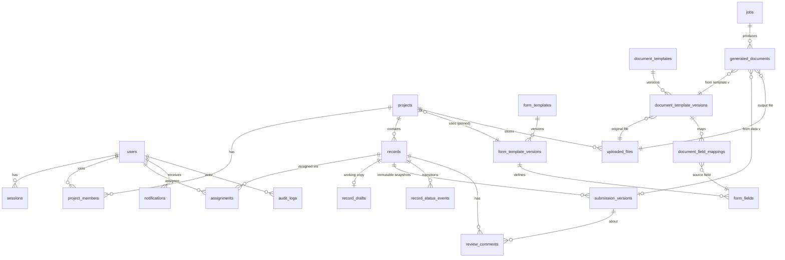

# TeamDocs — Architecture and Implementation Plan

Status: **PROPOSAL — awaiting approval before Phase 1**
Date: 2026-11-17

---

## 0. Repository inspection findings

The current repository (`djmagonsua-dev/answerlens`) contains an unrelated Android app:

| Path | Content |
|---|---|
| `AnswerLens-project.zip` | Zipped Android/Gradle project (Java) |
| `.github/workflows/build.yml` | Runs on **every push**, requires exactly one `.zip` in the repo root, builds an APK and **publishes a GitHub release** per run |
| `README.md` | One line |

Nothing in it is reusable for TeamDocs. Building TeamDocs here would trigger an APK build and a new release on every TeamDocs commit. **Recommendation: create a dedicated `teamdocs` repository.** (See Open Questions, Q1.)

---

## 1. System architecture

A **modular monolith**: one FastAPI codebase that runs as two processes (API and worker), plus one PostgreSQL database and a reverse proxy. No microservices, no Redis, no message broker.

```
            Android phones / PCs (browser or installed PWA)
                         │  HTTPS
     ┌───────────────────┼─────────────────────────────────────┐
     │  Windows 10/11 laptop — Docker Desktop (WSL2)           │
     │                   ▼                                     │
     │   ┌──────────────────────────────┐                      │
     │   │ caddy (only published port)  │  serves React build  │
     │   │ TLS, security headers, gzip  │  /api/* → api:8000   │
     │   └──────────────┬───────────────┘                      │
     │                  ▼                                      │
     │   ┌──────────────────────────────┐   ┌────────────────┐ │
     │   │ api  (FastAPI + Uvicorn)     │   │ worker (same   │ │
     │   │ auth, RBAC, forms, workflow, │   │ code, job loop)│ │
     │   │ uploads, downloads           │   │ doc generation,│ │
     │   └──────┬───────────────┬───────┘   │ exports, OCR,  │ │
     │          │               │           │ reminders,     │ │
     │          │   ┌───────────┴─────┐     │ backups        │ │
     │          │   │ storage volume  │◄────┤ LibreOffice    │ │
     │          │   │ /data/storage   │     └───────┬────────┘ │
     │          ▼   └─────────────────┘             │          │
     │   ┌──────────────────────────────┐           │          │
     │   │ db (PostgreSQL 16)           │◄──────────┘          │
     │   │ internal network only        │  jobs table = queue  │
     │   └──────────────────────────────┘                      │
     │   backups bind-mounted to C:\TeamDocs\backups           │
     └─────────────────────────────────────────────────────────┘
```

### Key design decisions

| Decision | Choice | Why |
|---|---|---|
| Background jobs | **PostgreSQL-backed job queue** (`jobs` table, `SELECT … FOR UPDATE SKIP LOCKED`), separate `worker` container | Avoids Redis/Celery. Durable, transactional, enough for 50–100 users. Jobs survive restarts. |
| Sessions | **Server-side sessions in PostgreSQL**, opaque random ID in an `HttpOnly; Secure; SameSite=Lax` cookie | Instant revocation on deactivation and logout; no JWT secret-rotation or revocation problems; works naturally with a same-origin SPA. |
| Frontend serving | Static React build served by **Caddy**, API under `/api` on the **same origin** | No CORS. Cookies stay first-party. Caddy also handles TLS. |
| Real-time progress | **Polling** with TanStack Query (15–30 s on dashboards) | Simple and reliable on flaky mobile networks. Server-Sent Events can come later if needed. |
| Document → PDF conversion | **LibreOffice headless inside the worker image** | python-docx, openpyxl and python-pptx cannot render PDF. LibreOffice is the only practical free, self-hosted converter. It adds about 500 MB to the worker image. |
| Page previews | LibreOffice → PDF, then **pypdfium2** → PNG page images | Android Chrome won't show PDFs inline; PNG previews work everywhere. pypdfium2 is permissively licensed (PyMuPDF is AGPL). |
| PDF form filling | **pypdf** (AcroForm), **ReportLab** for coordinate overlays and reports | Both permissively licensed, mature. |
| DOCX placeholders | **Own run-aware replacer** built on python-docx and lxml (not docxtpl/Jinja) | Jinja in admin-uploaded templates is a template-injection risk and conflicts with legal text containing braces. A narrow `{{FIELD}}` grammar is safer and predictable. |
| Calculated fields | **Own safe expression evaluator** (Python AST whitelist), with a mirrored TypeScript evaluator for instant preview, both tested against one shared JSON file of test cases | Never `eval()`. The server always recomputes and ignores client-sent calculated values. |
| Roles | Global role enum (`admin`, `reviewer`, `member`) **plus** per-project membership with a `can_approve` flag | Reviewers see only projects they're added to; approval rights are granted explicitly. |

---

## 2. Application folder structure

```
teamdocs/
├── docker-compose.yml
├── docker-compose.override.example.yml   # dev overrides (hot reload, exposed db for dev only)
├── .env.example
├── Caddyfile
├── Makefile / scripts/                   # PowerShell + bash helpers
│   ├── backup.ps1  restore.ps1  update.ps1  status.ps1
├── backend/
│   ├── Dockerfile                        # api image (slim)
│   ├── Dockerfile.worker                 # + LibreOffice, tesseract (phase 7.6), fonts
│   ├── pyproject.toml
│   ├── alembic.ini
│   ├── alembic/versions/
│   ├── app/
│   │   ├── main.py                       # FastAPI app factory, middleware
│   │   ├── config.py                     # pydantic-settings, env vars only
│   │   ├── db.py                         # engine, session, pooling
│   │   ├── security/                     # hashing, sessions, csrf, throttling, rate limits
│   │   ├── authz/                        # policies + scoped query builders (object-level auth)
│   │   ├── audit/                        # audit writer
│   │   ├── models/                       # SQLAlchemy models (one module per domain)
│   │   ├── schemas/                      # Pydantic request/response models
│   │   ├── modules/
│   │   │   ├── auth/  users/  projects/  files/
│   │   │   ├── forms/        # builder, validation, expression evaluator
│   │   │   ├── records/      # assignments, drafts, submissions, workflow state machine
│   │   │   ├── reviews/
│   │   │   ├── documents/    # Automation Studio
│   │   │   │   ├── analyzers/   docx.py xlsx.py pptx.py pdf_form.py pdf_ocr.py
│   │   │   │   ├── renderers/   docx.py xlsx.py pptx.py pdf_form.py pdf_overlay.py
│   │   │   │   └── convert.py   # LibreOffice wrapper with timeout + sandbox dir
│   │   │   ├── exports/  notifications/  dashboard/  settings/  backups/
│   │   ├── jobs/             # queue, worker loop, handlers, scheduler
│   │   └── storage/          # path layout, safe writes, streaming
│   ├── seed/                 # fictional demo data generator
│   └── tests/
│       ├── conftest.py       # real PostgreSQL test database, factories
│       ├── fixtures/files/   # sample + malformed DOCX/XLSX/PPTX/PDF
│       ├── test_auth.py  test_authz_idor.py  test_workflow.py  …
│       └── load/locustfile.py
├── frontend/
│   ├── Dockerfile            # node build → copied into caddy image
│   ├── package.json  vite.config.ts  tailwind.config.ts
│   ├── public/manifest.webmanifest  icons/
│   └── src/
│       ├── api/              # typed client (generated from OpenAPI)
│       ├── auth/  routes/  layouts/
│       ├── features/
│       │   ├── admin/  member/  review/  projects/  forms/  builder/
│       │   ├── studio/       # Document Automation Studio UI
│       │   └── exports/  notifications/  audit/
│       ├── components/ui/    # buttons, tables, status badges, dialogs
│       └── lib/expr/         # TS expression evaluator (preview only)
└── docs/
    ├── ARCHITECTURE.md  INSTALL-WINDOWS.md  DEPLOYMENT.md  BACKUP-RESTORE.md
    ├── ADMIN-MANUAL.md  MEMBER-GUIDE.md  TEMPLATE-GUIDE.md  SECURITY-CHECKLIST.md
    └── TROUBLESHOOTING.md
```

---

## 3. Entity relationship diagram



---

## 4. Table descriptions

All tables use `id BIGINT IDENTITY` internally, plus a `public_id UUID` exposed in URLs (avoids guessable sequential IDs; authorization is still enforced, see §6). All tables have `created_at` and `updated_at` (timestamptz, UTC).

### Identity and access
| Table | Purpose / key columns | Constraints |
|---|---|---|
| `users` | `username` (citext), `full_name`, `email` (nullable), `password_hash` (Argon2id), `role` enum(admin, reviewer, member), `status` enum(pending_approval, active, deactivated, rejected), `must_change_password`, `last_login_at`, `approved_by`, `approved_at` | unique `username`; unique `email` where not null |
| `sessions` | `token_hash` (SHA-256 of the cookie value; the raw token is never stored), `user_id`, `csrf_token`, `ip`, `user_agent`, `expires_at`, `last_seen_at`, `revoked_at` | index `(user_id)`, `(expires_at)` |
| `login_attempts` | `username`, `ip`, `succeeded`, `at` | Used for throttling; pruned after 30 days |
| `password_reset_tokens` | admin-issued one-time reset codes (hashed), `expires_at`, `used_at` | |

> The spec lists a `roles` table. With exactly three fixed roles, a PostgreSQL enum plus per-project flags is simpler and harder to misconfigure. A full permissions table can be added later if custom roles are ever needed.

### Projects
| Table | Purpose | Constraints |
|---|---|---|
| `projects` | `name`, `description`, `category`, `start_date`, `deadline`, `status` enum(draft, active, closed, archived), `form_template_version_id` (pinned) | |
| `project_members` | `project_id`, `user_id`, `project_role` enum(member, reviewer), `can_approve` bool | unique `(project_id, user_id)` |

### Forms
| Table | Purpose | Constraints |
|---|---|---|
| `form_templates` | Reusable form definition: `name`, `description`, `archived` | |
| `form_template_versions` | `version_no`, `status` (draft/published), `published_at`. **Published versions are immutable**; editing creates a new draft version. | unique `(form_template_id, version_no)` |
| `form_fields` | `key` (identifier, `^[a-z][a-z0-9_]{0,62}$`), `label`, `help_text`, `type` enum(short_text, long_text, integer, decimal, date, dropdown, radio, checkboxes, yes_no, email, phone, file, calculated), `required`, `default_value` jsonb, `validation` jsonb (min/max/length/pattern/decimals), `options` jsonb, `visible_if` jsonb (simple condition tree), `read_only`, `formula` text, `prefill_only` bool, `sort_order` | unique `(version_id, key)` |

### Records and workflow
| Table | Purpose | Constraints |
|---|---|---|
| `records` | One unit of work, e.g. "Participant 17". `project_id`, `label`, `seed_data` jsonb (admin-prefilled values, e.g. imported names), `status` enum(pending, in_progress, submitted, under_review, needs_correction, approved), `current_version_no`, `due_at`, `lock_version` (optimistic concurrency) | unique `(project_id, label)`; index `(project_id, status)` |
| `assignments` | `record_id`, `assignee_id`, `assigned_by`, `assigned_at`, `due_at`, `ended_at`, `end_reason` (reassigned/removed). Keeps the full assignment history. | **partial unique index: one active assignment per record** (`WHERE ended_at IS NULL`); index `(assignee_id) WHERE ended_at IS NULL` |
| `record_drafts` | The member's mutable working copy: `data` jsonb, `updated_by`, `updated_at`. This is what the spec calls `form_submissions`. | unique `(record_id)` |
| `submission_versions` | **Immutable snapshot** created on each submit: `version_no`, `data` jsonb (validated, with calculated values recomputed by the server), `form_template_version_id`, `submitted_by`, `submitted_at`, `attachments` (file IDs), `content_hash` | unique `(record_id, version_no)`; **a database trigger rejects UPDATE/DELETE** |
| `record_status_events` | `from_status`, `to_status`, `actor_id`, `note`, `at`. Insert-only. | trigger rejects UPDATE/DELETE |
| `review_comments` | `record_id`, `submission_version_id`, `author_id`, `body`, `field_key` (optional; ties a comment to one field), `kind` (comment / correction_request), `resolved_at` | |

**State machine** (enforced in one service function, inside a transaction holding a row lock on `records`):

```
pending ──start/save draft──► in_progress ──submit──► submitted ──open for review──► under_review
                                   ▲                                                 │      │
                                   │                                     request correction  approve
                                   └──── member edits ◄── needs_correction ◄─────────┘      ▼
                                                                                        approved
approved ──admin "reopen" (reason required)──► needs_correction
```

Any other transition returns HTTP 409. A double-submit or a race between two reviewers is caught by the row lock and status check.

### Files and document automation
| Table | Purpose |
|---|---|
| `uploaded_files` | `public_id`, `project_id` (nullable for system files), `kind` (original, template, attachment, generated, export, backup), `original_filename` (display only), `storage_key` (server-generated path), `mime_type` (detected), `size_bytes`, `sha256`, `capabilities` jsonb (uploadable/previewable/form_editable/generatable/download_only), `uploaded_by`, `record_id` (for attachments), `deleted_at` |
| `document_templates` | `name`, `format` (docx/xlsx/pptx/pdf_form/pdf_overlay), `project_id` (nullable = global), `is_legal_document`, `archived` |
| `document_template_versions` | `version_no`, `source_file_id` (original upload, never modified), `detected_fields` jsonb (analyzer output), `settings` jsonb (sheet/slide repeat rules, naming rule, flatten, draft-label), `status` (draft/published). Immutable once published. |
| `document_field_mappings` | `template_version_id`, `target` jsonb (e.g. `{"placeholder":"FULL_NAME"}`, `{"sheet":"Data","cell":"B2"}`, `{"slide":1,"shape_id":7}`, `{"acro_field":"name_1"}`, `{"page":1,"x":72,"y":640,"font":…}`), `source_field_key`, `format` (date/number formatting), `verified_by` (required for OCR-suggested mappings) |
| `jobs` | Unified job queue (spec's `export_jobs` + generation jobs): `type`, `payload` jsonb, `status` (queued/running/succeeded/failed/cancelled), `attempts`, `max_attempts`, `locked_by`, `lease_expires_at`, `progress`, `error`, `result_file_id`, `requested_by`, `run_after` |
| `generated_documents` | `job_id`, `record_id` (nullable for consolidated outputs), `template_version_id`, `submission_version_id`, `output_file_id`, `filename`, `is_draft_label_applied`, `generated_by`, `generated_at`, `superseded_by` (regeneration never overwrites; it creates a new row and file) |

### Cross-cutting
| Table | Purpose |
|---|---|
| `notifications` | `user_id`, `type`, `title`, `body`, `link`, `read_at`. Delivered through a `Notifier` interface (in-app now; email later). |
| `audit_logs` | `actor_id`, `action` (e.g. `record.approved`), `target_type`, `target_id`, `project_id`, `ip`, `metadata` jsonb, `at`. **Insert-only**: the application DB role has no UPDATE/DELETE grant, and a trigger also blocks it. Index `(target_type, target_id)`, `(actor_id, at)`, `(at)`. |
| `system_settings` | Key/value: upload limits, session lifetime, retention policy, backup schedule. |
| `backup_runs` | `started_at`, `finished_at`, `status`, `path`, `size`, `sha256_manifest`, `verified_at`. |

---

## 5. API endpoint plan (prefix `/api/v1`)

Every endpoint checks authentication, role, **and object scope** (§6). List endpoints are paginated (`?page=&page_size=`, max 100).

**Auth**
`POST /auth/login` · `POST /auth/logout` · `GET /auth/me` · `POST /auth/register` (self-registration → pending) · `POST /auth/change-password` · `POST /auth/reset` (with admin-issued code)

**Users (admin)**
`GET/POST /users` · `GET/PATCH /users/{id}` · `POST /users/{id}/approve|reject|deactivate|activate` · `POST /users/{id}/reset-password` (one-time code) · `POST /users/import/preview` (validate CSV/XLSX, show row errors) · `POST /users/import/commit` · `GET /users/import/template.xlsx`

**Projects**
`GET/POST /projects` · `GET/PATCH /projects/{id}` · `POST /projects/{id}/archive` · `GET/POST/DELETE /projects/{id}/members` · `GET /projects/{id}/progress`

**Forms**
`GET/POST /form-templates` · `GET /form-templates/{id}` · `POST /form-templates/{id}/versions` (new draft) · `PUT /form-template-versions/{vid}/fields` · `POST /form-template-versions/{vid}/publish` · `POST /form-templates/{id}/duplicate` · `POST /form-template-versions/{vid}/preview-calc`

**Records and assignments**
`GET/POST /projects/{id}/records` · `POST /projects/{id}/records/bulk` (create N records or import seed rows) · `POST /projects/{id}/assignments/bulk` · `POST /records/{id}/reassign` · `GET /records/{id}` · `GET /records/{id}/versions` · `GET /records/{id}/versions/{n}` · `GET /records/{id}/history`

**Member workflow**
`GET /me/assignments?status=` · `GET /me/dashboard` · `PUT /records/{id}/draft` (with `lock_version`) · `POST /records/{id}/attachments` · `POST /records/{id}/submit`

**Review**
`GET /review/queue?project=&status=` · `POST /records/{id}/start-review` · `POST /records/{id}/request-correction` · `POST /records/{id}/approve` · `POST /records/{id}/reopen` (admin) · `GET/POST /records/{id}/comments`

**Files**
`POST /projects/{id}/files` · `GET /projects/{id}/files` · `GET /files/{id}` (metadata) · `GET /files/{id}/download` (streamed, authorized) · `GET /files/{id}/preview/{page}.png` · `DELETE /files/{id}` (soft delete, admin)

**Document Automation Studio**
`GET/POST /doc-templates` · `POST /doc-templates/{id}/versions` (upload source file) · `POST /doc-template-versions/{vid}/analyze` (job) · `GET /doc-template-versions/{vid}/detected-fields` · `PUT /doc-template-versions/{vid}/mappings` · `POST /doc-template-versions/{vid}/create-form` (derive form fields from placeholders) · `POST /doc-template-versions/{vid}/preview` (render with a chosen record or sample data → job) · `POST /doc-template-versions/{vid}/publish` · `POST /doc-templates/{id}/duplicate|archive`

**Generation and exports**
`POST /projects/{id}/generate` (template version, record filter, naming rule, output formats, include-unapproved flag [admin only]) · `POST /projects/{id}/exports` (xlsx/csv/pdf report) · `GET /jobs/{id}` · `POST /jobs/{id}/cancel` · `GET /projects/{id}/generated-documents` · `GET /jobs/{id}/download` (ZIP)

**Dashboard, notifications, audit, settings, backups**
`GET /dashboard/admin` · `GET /notifications` · `POST /notifications/read` · `GET /audit-logs?actor=&action=&target=&from=&to=` (admin) · `GET/PATCH /settings` · `GET/POST /backups` · `GET /backups/{id}/verify` · `GET /health` (no data; for monitoring)

---

## 6. Authentication and authorization design

### Authentication
- **Argon2id** via `argon2-cffi` (RFC 9106 low-memory profile, roughly 64 MiB and 3 iterations, tuned so a laptop login takes about 0.3 s). Rehash on login if parameters change.
- Password policy: at least 10 characters, checked against a bundled common-password list. No forced composition rules.
- Admin-created and imported accounts get a one-time temporary password with `must_change_password=true`.
- **Sessions**: a 256-bit random token in the `td_session` cookie (`HttpOnly`, `Secure`, `SameSite=Lax`, `Path=/`). Only a SHA-256 hash of the token is stored. Idle timeout of 8 h and absolute lifetime of 30 days (configurable). The session ID rotates on login and privilege change. All sessions are revoked on deactivation or password reset.
- **CSRF**: a per-session token returned by `/auth/me`. The SPA sends it in an `X-CSRF-Token` header on every state-changing request, and the server compares in constant time. `SameSite=Lax` adds a second layer.
- **Login throttling**: per username and per IP, using a sliding window in `login_attempts`. After 5 failures, an exponential delay; after 20 failures in 15 minutes, the account is temporarily locked (admin can unlock). The error message is identical for unknown user and wrong password.
- **Rate limiting**: in-process limiter on auth, upload, and generation endpoints. That is enough because there is a single API instance; this is documented as a limit if it ever scales out.

### Authorization (three layers)
1. **Role gate** (dependency): `require_role(admin)` and similar on routes.
2. **Scoped queries**: every read goes through `authz/scopes.py` builders, for example:
   ```python
   def visible_records(user) -> Select:
       if user.role == ADMIN:  return select(Record)
       if user.role == REVIEWER: return select(Record).join(ProjectMember, …).where(ProjectMember.user_id == user.id)
       return select(Record).join(Assignment).where(Assignment.assignee_id == user.id, Assignment.ended_at.is_(None))
   ```
   An object is fetched **through** the scope (`visible_records(user).where(Record.public_id == rid)`). Out-of-scope objects return **404** (not 403), so IDs can't be probed.
3. **Action policies**: `can_edit_draft(user, record)` (assignee AND status in {pending, in_progress, needs_correction}), `can_approve(user, record)` (admin, or reviewer with `can_approve` on that project), and so on, in one module with unit tests.

Files are authorized through their owning object (project, record, or job). There is no direct path access.

**Tests** (Phase 1 onward): a parametrized IDOR suite. For every object endpoint, member A requests member B's record, attachment, version, file download, and job by `public_id`, and the test expects 404. A deactivated user's existing session must get 401.

Optional defense in depth for later: PostgreSQL row-level security on `records`. It is not planned for Phase 1 because it complicates pooling and migrations, and the scoped-query layer plus the tests cover the risk.

---

## 7. File storage architecture

```
/data/storage/                         (Docker named volume)
├── projects/{project_uuid}/
│   ├── originals/{file_uuid}.{ext}          # uploaded originals, write-once
│   ├── attachments/{record_uuid}/{file_uuid}.{ext}
│   ├── generated/{job_uuid}/{file_uuid}.{ext}
│   └── exports/{job_uuid}/{file_uuid}.{ext}
├── templates/{template_uuid}/v{n}/source.{ext}   # never modified after upload
├── previews/{file_uuid}/page-{n}.png              # cache, safe to delete
└── tmp/                                           # job scratch; cleaned on start
```

- **Write-once**: files are written to `tmp/`, fsynced, then atomically renamed. Existing paths are never opened for writing (`O_EXCL`). Regeneration writes a new file. "Original template is never overwritten" is enforced by code, not convention.
- Filenames on disk are UUIDs; the user's filename is kept only as metadata and sanitized for `Content-Disposition` (RFC 6266, ASCII fallback).
- **Upload validation**: extension allowlist, MIME sniffing with `libmagic`, and a structure check (OOXML zip opens and contains the expected `[Content_Types].xml`; PDF parses). **Zip-bomb guard**: total uncompressed size and entry count limits. Macro formats (`.docm`, `.xlsm`, `.pptm`) are rejected. Size limits: 25 MB default per file (configurable), enforced in streaming, plus a matching limit in Caddy.
- **Capability matrix** (stored per file, shown in the UI):

| Format | Upload | Preview | Form-mapped generation | Notes |
|---|---|---|---|---|
| DOCX | ✓ | ✓ (via PDF) | ✓ | primary format |
| XLSX | ✓ | ✓ | ✓ | |
| PPTX | ✓ | ✓ | ✓ | |
| PDF with AcroForm | ✓ | ✓ | ✓ | |
| PDF plain/scanned | ✓ | ✓ | ✓ via coordinate overlay (OCR-assisted in Phase 7.6) | |
| DOC / XLS / PPT (legacy) | ✓ | ✓ (via LibreOffice) | Only after an admin-confirmed conversion to DOCX/XLSX/PPTX, saved as a new template version | conversion may alter formatting; warned |
| CSV / TXT | ✓ | ✓ (text) | CSV usable as an import source | |
| JPG / PNG | ✓ | ✓ | – (can be placed into DOCX later) | EXIF stripped on preview |
| Other | admin-configurable | – | – | download-only |

- Downloads are streamed by FastAPI (`FileResponse`) after authorization, with `Content-Disposition: attachment`, `X-Content-Type-Options: nosniff`, and a sandboxing CSP. Caddy never serves `/data/storage` directly.
- Optional, not in scope by default: ClamAV scanning sidecar. It costs about 1 GB of RAM, so it is offered as an opt-in.

---

## 8. Document Automation Studio architecture

### Pipeline
```
upload source ─► analyze (job) ─► detected fields ─► admin maps / verifies ─► (optional) derive form
                                                                              │
     publish template version (immutable) ◄─────── preview with sample/real record (job)
                │
approved submission_versions ─► generate (job, per record or consolidated) ─► generated_documents + ZIP
```

Every generated document stores `template_version_id` and `submission_version_id`, so it can be traced exactly and reproduced.

### Format engines
| Format | Analyze | Render | Known limits (shown to admin) |
|---|---|---|---|
| **DOCX** | Scan every `w:p` in body, tables (including nested), headers, footers, footnotes, and text boxes (`w:txbxContent`). Find `{{KEY}}` across **runs**. Also detect content controls (`w:sdt` tag/alias) and bookmarks. | **Run-aware replacement**: concatenate run texts per paragraph, locate placeholder spans, write the value into the first run of the span (keeping its formatting), and remove the consumed text from the following runs. Line breaks in long text become `w:br`. Content controls: replace the `w:sdtContent` text. | Fields inside images, SmartArt, or WordArt are not supported. Conditional sections and repeating tables come later (phase 7 stretch). |
| **XLSX** | List sheets, existing `{{KEY}}` cells, defined names, and tables. | Mode A: cell mapping (one file per record). Mode B: **repeated rows**, where a start row and column→field map append one row per record, copying the style of the template row. Formulas kept as formulas; `fullCalcOnLoad` set so Excel recalculates on open. | openpyxl drops charts' cached data, pivot tables, slicers, and some images. Analysis warns when these are present and recommends a simple template. |
| **PPTX** | List slides, shapes (id, name, text), and `{{KEY}}` occurrences. | Mode A: text placeholders. Mode B: **repeat slide**, where the admin marks a template slide and the renderer deep-copies it once per record (shape tree plus image/media relationships), fills it, then removes the template slide. Order by a chosen field. | python-pptx has no official slide-copy API. A custom XML copy is needed; it will be tested on charts and images. Charts on repeated slides are not supported initially. |
| **PDF AcroForm** | `pypdf` lists fields (name, type, options, page, rect). | Fill, set `NeedAppearances`, optional flatten (render appearance streams via pypdfium2, or LibreOffice fallback). | Flattening fidelity varies with fonts. Signed or certified PDFs are refused, because filling them invalidates the signature. |
| **PDF overlay (plain or scanned)** | Render page images. Admin places boxes on a page canvas (x, y, width, font, size, alignment). Phase 7.6: Tesseract OCR suggests label positions ("Name:") as **unverified suggestions**. | ReportLab draws text on a transparent page, merged with `pypdf`. Text auto-shrinks to fit the box, with a warning on overflow. | OCR suggestions must be verified by an admin (`verified_by`) before publish. The original scanned content is never "edited", only overlaid. |

### Generation engine
- Jobs process records in chunks. Each record's output is written to `tmp/`, and the result row is inserted in the same transaction as the file move. A crashed job leaves no half-registered files.
- **Interrupted jobs**: the worker renews a lease every 30 s. If the lease expires (worker killed or laptop slept), another loop iteration requeues the job, and already-completed records are skipped (idempotency key `(job_id, record_id)`).
- LibreOffice runs with a dedicated per-job user profile directory and a hard timeout of 120 s per file, so a hung conversion can't block the queue. At most 1–2 conversions run concurrently (laptop CPU).
- Naming rules: a pattern such as `{{record.label}}_{{FULL_NAME}}_{{date}}.docx`, sanitized, with de-duplication suffixes.
- **Default output filter: approved records only.** Including unapproved records requires an admin, an explicit checkbox, and an audit entry; those outputs get an `INTERNAL REVIEW — NOT APPROVED` label.

### Legal-document safeguards (`is_legal_document = true`)
- Only mapped **placeholders** are replaced. The renderer cannot touch any other text, and there is no AI or auto-text generation anywhere in TeamDocs.
- When a new template version is uploaded, the system **diffs the non-placeholder text** against the previous version and requires the admin to acknowledge any change to declaration wording.
- Signature, jurat, and notary blocks are left untouched (they are just template text).
- Outputs are labelled as drafts: filename prefix `DRAFT_` and, by default, a header/footer line "DRAFT — not signed, sworn, or notarized" (see Q4). The UI never shows "signed", "sworn", or "notarized" states.
- Long-text fields on legal templates show members a notice that the statement is their own and that they are responsible for its truthfulness.

---

## 9. Docker deployment architecture

`docker-compose.yml` services:

| Service | Image | Ports | Volumes | Notes |
|---|---|---|---|---|
| `caddy` | caddy:2 + built frontend | **80, 443 (only published ports)** | `caddy_data` | TLS, HSTS, CSP, request-size limit |
| `api` | backend | internal 8000 | `storage` | Uvicorn, 2 workers, runs `alembic upgrade head` on start via an init step |
| `worker` | backend + LibreOffice + fonts (+ tesseract later) | none | `storage`, `backups` | job loop, scheduler (reminders, backups, cleanup) |
| `db` | postgres:16 | **none** (internal network only) | `pgdata` | `scram-sha-256`, separate app role without DDL/UPDATE-on-audit rights |

- Networks: `edge` (caddy↔api) and `internal` (api, worker, db; `internal: true`).
- `restart: unless-stopped` on all services. Health checks on db and api.
- **Volumes**: `pgdata` and `storage` are **named volumes** inside WSL2 (bind-mounting Postgres data onto NTFS is slow and causes permission problems). `backups` is a **bind mount to `C:\TeamDocs\backups`**, so backups are visible in Windows Explorer and can be copied to external or cloud storage.
- Secrets come from `.env` (never committed): `POSTGRES_PASSWORD`, `APP_SECRET_KEY`, `INITIAL_ADMIN_*`. `.env.example` is committed.
- Resource needs: about 2–3 GB RAM total at idle; the worker peaks during LibreOffice conversions. Recommended laptop: 8 GB RAM minimum (16 GB preferred), SSD, 20 GB free disk.

### Network access
- **Local Wi-Fi**: members open `https://<laptop-hostname-or-IP>`. Windows Firewall needs an inbound rule for 80/443 on the **Private** profile only. The router should give the laptop a DHCP reservation.
- **Remote**: Tailscale on the laptop; `tailscale serve` provides a valid HTTPS certificate on `https://teamdocs.<tailnet>.ts.net`. There is no port forwarding and the database is never exposed.
- **HTTPS matters for Android**: PWA install, service workers, and `Secure` cookies require HTTPS. Plain `http://192.168.x.x` would not allow PWA install. Options are in Q2.
- The laptop must be on, awake, and connected. Power settings: no sleep on AC power. Docker Desktop must be set to start on login, and **someone must be signed in to Windows** for Docker Desktop to run (a documented limitation).

---

## 10. Security and privacy considerations

- OWASP ASVS L2-style checklist delivered in `SECURITY-CHECKLIST.md`.
- **Injection**: SQLAlchemy parameterized queries only; no raw string SQL. Pydantic validation on every input, with `extra="forbid"` on request models.
- **XSS**: React escapes by default; no `dangerouslySetInnerHTML`. Strict CSP (`default-src 'self'`). User-supplied text such as help text and comments is rendered as plain text, not HTML.
- **Mass assignment / tampering**: calculated fields, status, assignee, and version numbers are never accepted from the client. Draft data is filtered to the form's known field keys and validated by type.
- **Headers** (Caddy): HSTS, `X-Content-Type-Options`, `Referrer-Policy: same-origin`, `Permissions-Policy`, `frame-ancestors 'none'`.
- **Secrets**: only in `.env` and environment variables; the frontend bundle contains no secrets. Startup refuses to run with default or weak `APP_SECRET_KEY` and DB passwords.
- **Data Privacy Act of 2012 (RA 10173)** alignment:
  - Data minimization: form builder warns about sensitive personal information field types; no hidden collection.
  - Access control and audit logs (§6, §4).
  - Configurable retention per project: after closure plus N days, admin can purge attachments and personal data. The purge is itself logged; aggregate counts are kept.
  - Self-registration shows a privacy notice and consent checkbox (text editable by admin).
  - Data-subject access: admin can export everything held about one user.
  - Breach response: audit logs plus guidance in the admin manual.
  - **Recommend BitLocker** on the laptop (encrypts volumes at rest) and encrypted off-site backup copies.
- Seed data is **fictional only** (generated names like "Demo Participant 07").
- Dependency hygiene: pinned versions, `pip-audit` and `npm audit` in the test script.

---

## 11. Development roadmap with dependencies

```
P1 Foundation ─► P2 Users ─► P3 Projects & Files ─► P4 Form Builder ─► P5 Assignments & Member Workflow ─► P6 Review & Approval
                                       │                                                                        │
                                       └──────────────────────────────► P7 Document Automation Studio ◄─────────┘
                                                                                   │
                                                                   P8 Reporting ◄──┘
                                                 P9 Security & Performance (runs across all; final pass here)
                                                 P10 Deployment & Guides (Windows docs drafted from P1, finalized here)
```

| Phase | Deliverables | Done when |
|---|---|---|
| **1 Foundation** | Repo layout, Compose (caddy/api/worker/db), Alembic baseline, config, structured JSON logging, session auth, CSRF, throttling, role gates, scoped-query framework, audit writer, job-queue skeleton, React shell (login, layout, routing, PWA manifest), CI test script | `docker compose up` works; auth and IDOR test harness green |
| **2 Users** | Admin CRUD, self-registration + approval, CSV/XLSX import with preview and row-level errors, password reset codes, user dashboard | tests: import errors, duplicates, approval, deactivation kills sessions |
| **3 Projects & Files** | Projects, membership, upload pipeline + validation, capability matrix, streaming download, previews (needs worker + LibreOffice) | malformed/oversized/zip-bomb file tests |
| **4 Form Builder** | Versioned forms, all field types, validation, conditional visibility, expression evaluator (BMI), mobile form renderer | shared Python/TS evaluator test file passes on both sides |
| **5 Assignments & Member Workflow** | Records, bulk create/import, assignment/reassignment, member dashboard, autosaved drafts (server + local), attachments, submit | duplicate-submit and concurrent-edit tests |
| **6 Review & Approval** | Review queue, correction requests with field-level comments, resubmission, approve, reopen, version history/diff, notifications, admin dashboard | full workflow tests; immutability trigger tests |
| **7 Automation Studio** | 7.1 DOCX → 7.2 XLSX → 7.3 batch generation + ZIP → 7.4 AcroForm PDF → 7.5 PPTX repeat slides → 7.6 overlay + OCR suggestions | golden-file tests per format (render, re-open, assert values + untouched text) |
| **8 Reporting** | XLSX/CSV/PDF reports with filters, approved-only default, export audit | export permission tests |
| **9 Security & Performance** | Security review against checklist, Locust test (e.g. 40 concurrent users saving drafts + 1 batch job), backup/restore drill, error pages | measured p95 latencies documented |
| **10 Deployment** | Windows install guide, PowerShell scripts, Tailscale guide, admin manual, member guide (with screenshots), template guide | fresh-install walkthrough on a clean Windows VM/laptop |

Tests are written within each phase; nothing moves to the next phase with failing tests.

---

## 12. Required software and prerequisites

**Host laptop**
- Windows 10 22H2 or Windows 11, 64-bit, with hardware virtualization enabled in BIOS/UEFI.
- WSL 2 (`wsl --install`).
- Docker Desktop for Windows (WSL2 backend). **Licensing note**: Docker Desktop is free only for personal use, education, non-commercial open source, and small businesses (fewer than 250 employees and less than US$10M revenue). Government agencies and larger organizations need a paid subscription. **Free alternative**: Docker Engine installed directly inside WSL2 Ubuntu. The same Compose file works; I'll document both.
- Tailscale for Windows (remote access).
- Git for Windows (for updates), or ZIP releases.
- 8 GB RAM minimum (16 GB recommended), 20 GB free SSD space, plus external drive or cloud folder for off-site backups.

**Members**: an Android phone with Chrome (recent) or any modern desktop browser. Remote members also need the Tailscale app.

**Development** (handled in this environment): Python 3.12, Node 20+, PostgreSQL 16, LibreOffice 7+, Tesseract 5 (Phase 7.6).

---

## 13. Technical risks and assumptions

| # | Risk / assumption | Mitigation |
|---|---|---|
| R1 | **Tailscale free-plan limits**: the free Personal plan has historically allowed only **3 users**. 50–100 members each needing their own account would exceed it. | Options: (a) paid Tailscale plan for remote members only; (b) share the laptop node to members' own tailnets (node sharing); (c) most members connect on local Wi-Fi only. **Verify current pricing.** (Q2) |
| R2 | HTTPS on the LAN without Tailscale needs a trusted certificate; self-signed CAs are painful to install on Android. | Prefer Tailscale HTTPS for everyone, or accept that on-LAN plain-HTTP users can't install the PWA. (Q2) |
| R3 | Laptop as a server: sleep, Windows Update restarts, battery, theft. | No-sleep power plan, active hours, UPS-like battery, BitLocker, daily backups copied off the laptop, documented recovery. |
| R4 | Fidelity of generated documents (fonts, complex layouts). | Golden tests; preview before batch; install common fonts (Liberation, Carlito/Caladea metric-compatible with Calibri/Cambria; Arial/Times compatible) in the worker. Exact Microsoft fonts can be added if the organization is licensed. |
| R5 | openpyxl and python-pptx drop or mangle unsupported features (charts, pivots, SmartArt). | Analyzer warns explicitly; recommend simplified templates; the original file is always kept. |
| R6 | PPTX slide duplication is not an official python-pptx API. | Custom XML copy with relationship handling; tested on images and tables; charts excluded initially. |
| R7 | OCR quality on phone-scanned forms is poor. | OCR is suggestion-only; manual overlay placement is always available. |
| R8 | LibreOffice in the worker image (about 500 MB) and CPU spikes on the laptop. | Concurrency limit of 1–2; jobs queued; members' requests aren't affected because conversions run in the worker container. |
| R9 | Mobile connectivity drops mid-form. | Autosave to the server every few seconds when online, plus a local copy (IndexedDB) restored on reopen; idempotent submit. **Not** full offline mode. |
| A1 | One primary admin; fewer than 20 truly concurrent users at peak. | Load test at 40 concurrent to leave headroom. |
| A2 | English UI initially. | i18n-ready string structure; Filipino translation can be added. |
| A3 | No email in v1; password resets are handled by the admin issuing a one-time code. | `Notifier` interface allows SMTP later. |

---

## 14. Open questions (need answers before Phase 1)

1. **Repository**: create a new dedicated `teamdocs` repo (recommended), or build inside `answerlens` (requires removing or restricting its APK release workflow)?
2. **Remote and HTTPS model**: (a) everyone, including on-site members, connects through Tailscale HTTPS (best: PWA works; members install the Tailscale app; possible plan cost); (b) LAN over HTTPS with a local certificate for on-site members, Tailscale for a few remote ones; (c) LAN over plain HTTP (simplest, but no PWA install, and passwords travel unencrypted on the Wi-Fi). Recommended: (a).
3. **Records**: should admins be able to pre-create records with prefilled data (e.g. import 32 participant names and birthdates) before assigning, in addition to blank one-per-member records? Planned: yes, both.
4. **Affidavit draft label**: OK to stamp "DRAFT — not signed, sworn, or notarized" in the header/footer of generated legal documents by default (admin can turn it off per template, and turning it off is audited)? Or filename prefix only, leaving the document body untouched?
5. **Reviewer approvals**: grant per project (planned), or allow all reviewers to approve by default?
